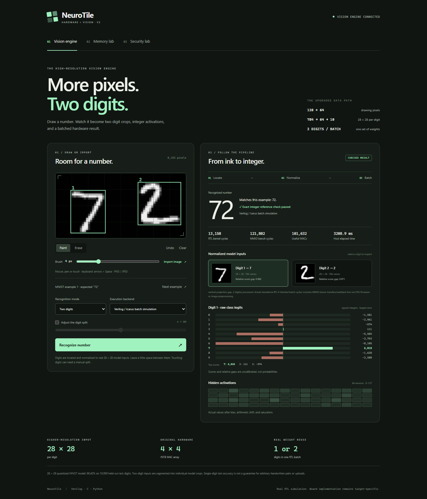
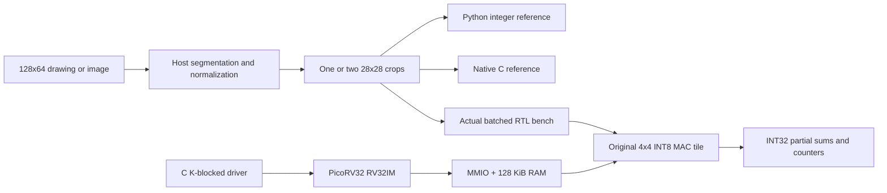

# NeuroTile 2

### More pixels. Two digits. Real integer hardware.

NeuroTile is a simulation-first AI computer built around an original **4×4
Verilog INT8 matrix accelerator**, C firmware and trained neural networks.
Version 2 recognizes **one or two handwritten digits** on a 128×64 canvas,
shows detected regions and normalized inputs, and runs the result through
Python, native C or the actual RTL accelerator.



**Offline model included · Python/C/RTL agreement · No FPGA required to start**

## What changed in version 2

| Capability | Implemented behavior |
|---|---|
| Larger input | 128×64 drawing canvas: 8,192 pixels, with mouse, pen, touch and keyboard input |
| Higher-resolution learning | Genuine 28×28 MNIST model per digit, 784→64→10; the old 8×8 classifier is retained separately |
| Two-digit recognition | Automatic foreground segmentation or manual split; classify left to right and retain leading zeros |
| Better editing | Variable brush, eraser, undo, examples, and PNG/JPEG import with automatic ink-polarity handling |
| Inspectable preprocessing | Detected boxes, selectable normalized crops, blank-input rejection and ambiguity messages |
| Inspectable output | Actual per-digit logits and hidden activations, top-three alternatives and a score-gap heuristic |
| Hardware batching | Two crops share weight transfers and run as two matrix rows on the Verilog accelerator |
| Larger-network scheduling | K-blocked inference, exact INT32 partial-sum accumulation, C driver and RISC-V benchmark firmware |

The **canvas** and **model** resolutions serve different purposes. Host software
segments the 128×64 image. Each detected digit becomes a genuine 28×28 model
input: 784 learned input features, compared with 64 in the original network.
Two-digit recognition composes two predictions; it is not a sequence-trained
OCR model.

## Run the demo

From this folder, with Python 3.12 or later:

```sh
python tools/serve.py
```

Open **http://127.0.0.1:8000**. Python inference, the bundled model, examples
and architecture labs work offline using the Python standard library. Available
C and RTL backends are enabled automatically.

1. Run the initial example, or draw one or two digits with space between them.
2. Choose **Auto detect**, **One digit** or **Two digits**. Adjust the split for touching digits.
3. Select Python, C or Verilog and run recognition.
4. Inspect each normalized crop, its signed logits and its hidden activations.

PNG/JPEG files are decoded in your browser and placed on the canvas. The API
receives the pixel array; no external upload service is used. If an old server
is running, stop it with Ctrl+C, restart the command and refresh the page.

Read the [vision guide](docs/highres-vision.md), [model guide](docs/highres-model.md)
and [hardware guide](docs/highres-hardware.md) for the implemented details.

## Results, with their actual scope

| Measurement | Result | Scope |
|---|---:|---|
| MNIST integer accuracy | **96.42%: 9,642/10,000** | All official test digits; trained on 20,000 official-training samples |
| Synthetic exact-pair recognition | **94/100 pairs** | Consecutive test images 0–199, composed side by side; includes segmentation/normalization |
| Digit accuracy in that experiment | **97%** | 200 digit positions in those same 100 pairs |
| Two regions found | **100/100 pairs** | The same separated synthetic examples |
| Two-digit batch kernel cycles | **13,158** | Actual RTL MAC counters across 14 launches |
| Two-digit batch transaction cycles | **121,802** | Standalone RTL driver, transfers and partial-sum accumulation included |
| Two separate transactions | **2×118,422** | The same two inputs classified independently |
| Batching improvement | **1.9445×** | Separate transaction total divided by batched transaction cycles |

The pair experiment uses **synthetic side-by-side MNIST composition**, not
naturally written two-digit samples. It takes consecutive held-out images
without filtering successes. Executed results are in
[recognition.json](reports/recognition.json) and [hd_benchmark.json](reports/hd_benchmark.json).

Batching reuses weight transfers and tile launches. The 1.9445× figure is not a
whole-application or physical FPGA speedup. Standalone RTL cycles, CPU firmware
cycles and host simulation time are separate measurements. The high-resolution
CPU benchmark is a separate measurement. The executed two-input run took
3,061,160 cycles in C and 1,204,060 cycles with acceleration: **2.5424×**, with
CPU copies, block accumulation and activation included. Both paths use the same
PicoRV32 RV32IM configuration with its fast multiplier enabled and C compiled
with `-O2`. The inputs are the default sample and a synthetic mirror used for
correctness, rather than a labeled pair-accuracy test. Image preprocessing and
host transport are excluded. See [hd_soc.json](reports/hd_soc.json) and reproduce
it with `python tools/build.py hd-soc`.

The new model needs **50,816 useful MACs** and **51,112 parameter bytes** per
digit, excluding buffers and metadata. Logits are scores rather than
probabilities. The relative score gap is an inspection heuristic, not calibrated
confidence. Dataset accuracy does not guarantee results on arbitrary drawings,
photos, touching digits or noisy backgrounds.

## Architecture



Each accelerator launch supports K≤64. The 784-input first layer uses twelve
64-input blocks and one 16-input tail. The driver adds their INT32 results
before bias, shift and clipping. The final layer maps 64 hidden values to 10
outputs. A two-digit batch shares weight blocks across two rows of matrix A.

The synthesizable accelerator uses an **output-stationary broadcast MAC tile**.
The CPU/host performs explicit tensor copies; this version has no DMA, cache
coherence or operating system. Image segmentation runs on the host. The
unchanged register map is in [docs/accelerator.md](docs/accelerator.md).

## Install the verification toolchain

On Ubuntu/Debian, including Ubuntu in WSL:

```sh
sudo apt-get update
sudo apt-get install -y gcc iverilog gcc-riscv64-unknown-elf binutils-riscv64-unknown-elf yosys
```

NumPy is needed only for training and its reproduction tests:

```sh
python -m pip install -r requirements-training.txt
python tools/build.py doctor
python tools/check.py --require-tools --synth
```

Use `python3` if that is your Linux executable. On Windows, install hardware
tools in WSL Ubuntu while running these commands from PowerShell. The helper
prefers native executables and otherwise bridges to WSL. Set
`NEUROTILE_WSL_DISTRO` for another distro name. Executable overrides such as
`IVERILOG`, `VVP` and `RISCV64_UNKNOWN_ELF_GCC` are supported.

`python tools/check.py` reports explicit skips for unavailable dependencies.
`--require-tools` makes missing tools or skipped checks a failure. The suite
uses `unittest`; pytest and an npm build are unnecessary.

## Commands for version 2

| Command | What it does |
|---|---|
| `python tools/serve.py` | Launch the larger-canvas recognition interface |
| `python tools/build.py hd-infer` | Run a genuine 28×28 sample through real RTL |
| `python tools/hd_infer.py --backend c` | Run the native C high-resolution reference |
| `python tools/hd_infer.py --input crops.json` | Classify one or two supplied 784-pixel crops in RTL |
| `python tools/build.py hd-firmware` | Compile K-blocked RISC-V benchmark firmware |
| `python tools/build.py hd-soc` | Boot the processor and compare C/accelerated high-resolution inference |
| `python tools/benchmark_hd.py` | Measure RTL batching and evaluate 100 composed held-out pairs |
| `python tools/benchmark_hd.py --reference-only --pairs 100` | Regenerate pair results without hardware tools |
| `python tools/train_hd_model.py` | Retrain and export the MNIST integer model offline |
| `python tools/build.py accel` | Run randomized matrix/MMIO verification |
| `python tools/check.py --require-tools --synth` | Run the full regression and regenerate evidence |

`crops.json` contains one or two arrays of 784 integers in 0–16. These are already
normalized inputs; canvas recognition uses `/api/recognize`, described in the
vision guide. C and RTL return their own activations/logits and compare every
value with Python.

Training uses a stratified 20,000-image subset of official MNIST training data
and all 10,000 untouched official test images. There is no test-based early
stopping or parameter search. Float32 training varies between BLAS builds;
tests distinguish the committed model's golden accuracy from repeatability of
fresh training on the current machine. See [dataset provenance](data/mnist_README.md).

## Retained legacy system and companion labs

The original 8×8 UCI classifier, CPU benchmark and UART protocol remain available
for smaller-memory experiments. They use 64→32→10, not the MNIST network. The
board-neutral UART top still accepts legacy 64-pixel requests. The new model has
a full-SoC benchmark; a high-resolution UART request protocol is not claimed.

| Command | Retained experiment |
|---|---|
| `python tools/build.py infer` | Legacy 8×8 standalone RTL inference |
| `python tools/build.py soc` | Legacy CPU software/accelerated comparison |
| `python tools/build.py soc --vcd` | Legacy CPU waveform capture |
| `python tools/build.py interactive` | Legacy UART firmware |
| `python tools/build.py uart-soc` | Legacy UART/CPU/accelerator wire simulation |
| `python tools/train_model.py` | Legacy UCI trainer |
| `python tools/labs.py` | Modeled adaptive-memory and cache-isolation experiments |
| `python tools/build.py labs` | Standalone lab RTL harness |
| `python tools/build.py synth` | Generic accelerator synthesis statistics |

The Memory and Security tabs are independent experiments, not components wired
into the inference CPU. The learned memory policy ties its handwritten rule on
the default held-out traces; fixed stride wins the aggregate. The security lab
measures one controlled timing channel and isolation's capacity cost, not
general processor security.

See [lab assumptions](docs/labs.md), [legacy architecture](docs/architecture.md),
[legacy demo](docs/demo-guide.md), [UART](docs/uart.md) and [FPGA bring-up](docs/fpga.md).
Legacy guides describe the 8×8 path unless they explicitly mention MNIST.

## Verification and physical limits

Checks cover the full official MNIST test set, model hashes/C exports, training
repeatability, blank/noise/split/normalization behavior, C/RTL single/batched
agreement, K-block tail accumulation, accelerator signed extrema/MMIO/reset/
counters, CPU boot, legacy UART and the architecture labs. Current evidence is
in [reports/verification.json](reports/verification.json); the running suite
generates its test count.

The full processor simulation can take several minutes. The GitHub Actions
workflow allows 25 minutes including dependency setup; inspect its first hosted run
after publishing. Yosys reports are generic structure/cell checks. No physical
board test, post-route clock, FPGA power or device-utilization result is
claimed. Multiport asynchronous scratchpads may need banking/pipelining for
block RAM. Pins, I/O standards and physical timing remain board-specific work.

## Repository map

```text
rtl/                 Original MAC tile, SoC, UART and board-neutral top
rtl/labs/            Learned selector and domain-isolated cache prototypes
sim/                 Matrix, legacy/HD inference, CPU, UART and lab benches
firmware/            C references, legacy/HD drivers, firmware and startup
firmware/generated/  Quantized UCI and MNIST model headers
python/neurotile/    Integer models, datasets, vision and experiment code
data/                Attributed offline data, subset indices and hashes
models/              Quantized models, examples, metrics and SHA256 files
web/                 Local canvas, import, crops, logits and lab interface
tools/               Build, train, infer, benchmark, serve and package tools
tests/               Software and RTL integration regression
docs/                High-resolution and legacy implementation guides
reports/             Executed verification and experiment evidence
third_party/         Pinned unmodified ISC-licensed PicoRV32 source
.github/workflows/   Linux verification workflow
```

## Package and upload later

`python tools/package.py` creates a clean `neurotile.zip` alongside this folder
and a per-file `SHA256SUMS` manifest. Build outputs, scratch files and caches are
excluded. Upload the contents to a repository with your preferred visibility,
retaining dataset attribution and third-party licenses.

Next experiments include banked scratchpads, DMA/double buffering, a
nearest-neighbor systolic dataflow, or sequence-trained recognition for touching
and longer numbers. These are extension ideas, not implemented claims.

## License and references

Original source is [MIT licensed](LICENSE). PicoRV32 retains ISC. The ylecun
dataset card identifies MNIST as MIT; legacy UCI digits remain CC BY 4.0.
Attribution and transformations are in [NOTICE.md](NOTICE.md).

- [MNIST](https://huggingface.co/datasets/ylecun/mnist/blob/main/README.md),
  Yann LeCun, Corinna Cortes and Christopher J. C. Burges.
- [PicoRV32](https://github.com/YosysHQ/picorv32), pinned commit
  `ef203c2b0a3fb793280f5114941416c425c5b461`; upstream is archived.
- [Berkeley Gemmini](https://github.com/ucb-bar/gemmini), architectural inspiration;
  its Chisel source is not included.
- [IP-classified prefetching](https://www.cse.iitk.ac.in/users/biswap/DPC3.pdf),
  inspiration for the adaptive-memory experiment.
- [DAWG](https://dspace.mit.edu/entities/publication/15d7aefb-e266-401c-ba9a-b18b4493090c),
  inspiration for the cache-isolation experiment.
- [UCI Optical Recognition of Handwritten Digits](https://doi.org/10.24432/C50P49),
  E. Alpaydin and C. Kaynak (1998), retained for legacy experiments.
