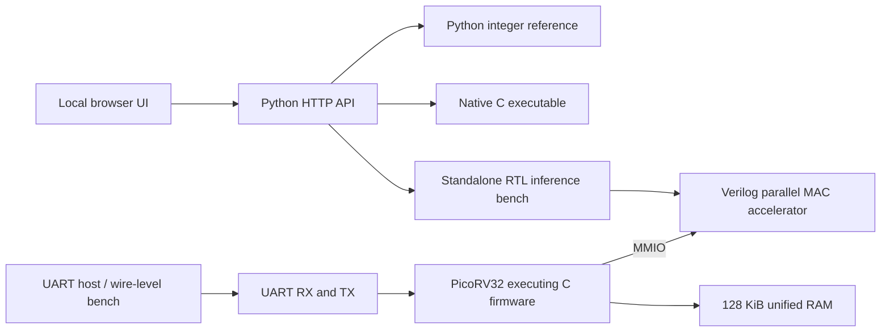

# NeuroTile architecture

This document describes the original 8×8 pipeline and shared SoC/register design.
The main browser now uses the genuine 28×28 MNIST model and a 128×64 drawing
canvas. Read [highres-hardware.md](highres-hardware.md),
[highres-model.md](highres-model.md) and [highres-vision.md](highres-vision.md)
for the v2 batching, larger model and image-processing paths. The accelerator
register map below remains valid for both versions.

NeuroTile contains an integer AI accelerator, a small RISC-V computer that uses
it, a local inference interface, and two independent cache architecture labs.
The local interface's RTL backend runs an actual accelerator simulation. The
separate SoC benchmark executes compiled C firmware on the simulated CPU.

## Execution paths



The API compares native C and standalone RTL predictions, hidden activations,
and logits against Python's integer reference. The native C backend does not
execute RISC-V instructions. The standalone RTL inference bench directly drives
the accelerator bus and performs layer bias/activation sequencing in the bench;
it also does not execute the CPU. `tools/build.py soc` and `uart-soc` exercise
the CPU/firmware paths.

## The 4×4 arithmetic array

`rtl/neurotile_accel.v` computes a row-major matrix product:

```text
C[M,N] = A[M,K] × B[K,N]
1 ≤ M ≤ 16; 1 ≤ N ≤ 64; 1 ≤ K ≤ 64
A and B: signed INT8; C: signed INT32 raw sums
```

Sixteen `mac_pe` instances retain one output partial sum each. Every reduction
step broadcasts four A values across the rows and four B values down the
columns. Active PEs perform sixteen or fewer independent multiply-accumulates.
The controller clears accumulators, iterates over K, stores the tile, and moves
to the next output tile. Partial edge tiles gate unused lanes and do not write
outside the output matrix.

This is a **broadcast, output-stationary parallel MAC array**. It does not shift
operands between neighboring PEs as a systolic array would. No DMA, overlapping
tile transfers, or hardware bias/activation unit is present. A single digit is
M=1, so only one PE row is active; larger M values are verified by the matrix
regression but are not exposed as batched inference in the browser.

For `T = ceil(M/4) × ceil(N/4)`:

```text
kernel cycles = T × (K + 2)    # clear + K reduction steps + store
useful MACs   = M × N × K
tile count   = T
```

`mac_pe.v` multiplies two signed 8-bit inputs, sign-extends the 16-bit product,
and adds it to a signed 32-bit accumulator. For legal K, raw sums fit INT32 even
at signed input extremes. SRAM contents are not reset; control state,
accumulators, dimensions, and counters are reset. Software initializes operands
before use and treats results as valid only after command completion.

### Accelerator MMIO

The accelerator bus receives 16-bit **byte offsets**. SoC addresses add
`0x10000000`. Transfers complete on a rising edge with valid and ready asserted;
the accelerator inserts no wait states. A/B elements each occupy one bus word,
although only its low byte is stored. This is not packed four-byte input data.

| Offset | Meaning |
|---|---|
| `0x0000` | Read-only ID `0x4e543031` |
| `0x0004` | CONTROL: bit 0 start, bit 1 clear sticky done/error |
| `0x0008` | STATUS: busy bit 0, done bit 1, error bit 2 |
| `0x000c`, `0x0010`, `0x0014` | M, N, K configuration |
| `0x0018`, `0x001c`, `0x0020` | Kernel cycles, useful MACs, completed tiles |
| `0x1000 + 4i`, `0 ≤ i < 1024` | A scratchpad: 1,024 signed bytes |
| `0x2000 + 4i`, `0 ≤ i < 4096` | B scratchpad: 4,096 signed bytes |
| `0x6000 + 4i`, `0 ≤ i < 1024` | Read-only C scratchpad: 1,024 signed words |

A valid start snapshots dimensions and clears counters, done, and error. New
starts, effective operand writes, and configuration writes while busy are
rejected with sticky error. Invalid dimensions do not start work. Configuration
writes merge enabled bytes; operands obey only byte enable 0. Result/ID writes
and unaligned or unmapped writes set error. Reads of unmapped or unaligned
locations return zero. The done IRQ is a level; the current CPU firmware polls
STATUS instead of enabling CPU interrupts. Complete semantics are in
[accelerator.md](accelerator.md).

## The quantized digit model

The committed model is a 64-input, 32-hidden, 10-output dense network trained on
the official UCI Optical Digits writer-disjoint split. Each input is an 8×8
image flattened row-major, with integer pixels in 0–16. Training and calibration
run offline; neither the FPGA design nor the browser trains a model.

Weights are signed 8-bit integers, biases are signed 32-bit integers, and hidden
activations are nonnegative INT8 values. Flat weight arrays use input-major
row-major layout: `weight[input_index * output_count + output_index]`.

```text
raw_hidden[j] = Σ pixels[i] × w1[i,j]
hidden[j]     = clamp(floor((raw_hidden[j] + b1[j]) / 2^hidden_shift), 0, 127)
logit[j]      = Σ hidden[i] × w2[i,j] + b2[j]
prediction    = first index with the largest logit
```

The exported model supplies `hidden_shift` (6 in the committed model).
`firmware/quant.h` explicitly implements floor division for negative inputs,
so C agrees with Python arithmetic right shift rather than relying on
implementation-defined negative shifts. In firmware, C adds biases and applies
activation between accelerator calls. The standalone RTL inference bench
performs the same operations around the matrix engine.

Offline training uses NumPy and minibatch Adam. Weight quantization rounds to
nearest with ties to even, using symmetric per-layer scales and weight range
−127…127. Training activations alone determine the hidden power-of-two shift.
The final class scores are raw signed integer logits; inference does not compute
softmax probabilities. This is a defined project-specific quantization format,
not a general LiteRT/ONNX model executor.

The two matrix calls are `(M,N,K)=(1,32,64)` and `(1,10,32)`:

| Layer | Useful MACs | Tiles | Kernel cycles |
|---|---:|---:|---:|
| Input → hidden | 2,048 | 8 | 528 |
| Hidden → logits | 320 | 3 | 102 |
| Total | 2,368 | 11 | 630 |

Model JSON, the generated C header, metrics, dataset provenance, and a model
checksum are supplied in `models/`, `firmware/generated/`, and `data/`.

## RISC-V SoC and memory map

`rtl/neurotile_soc.v` instantiates the vendored PicoRV32 core configured for
RV32IM, the original accelerator, unified RAM, and a small I/O block. Instruction
and data requests share the native CPU bus. The design has no CPU cache, MMU,
OS, or integrated adaptive prefetcher.

RAM contains 32,768 32-bit words, or 128 KiB. Reset execution begins at address
zero. `firmware/start.S` initializes the global pointer, sets the stack at
`0x00020000`, clears BSS, and calls C `main`. The build creates a padded RAM
initialization file from the linked firmware ELF.

| SoC address | Meaning |
|---|---|
| `0x00000000`–`0x0001ffff` | 128 KiB unified firmware/data/stack RAM |
| `0x10000000`–`0x1000ffff` | Accelerator offset window; defined offsets above |
| `0x20000000` | TX/console: write low byte; a busy physical TX stalls the CPU write |
| `0x20000004` | Completion: 0 clears completion, 1 indicates pass/done, other nonzero values indicate failure |
| `0x20000008` | Read-only 32-bit free-running SoC cycle counter |
| `0x2000000c` | RX read: bit 31 valid, bits 7:0 byte; reading consumes a valid buffered byte |
| `0x20000010` | UART status: TX ready bit 0, RX valid bit 1, sticky overrun bit 2 |

In the simple SoC benchmark, the testbench accepts console bytes directly. That
parallel console interface is not a UART wire. The FPGA wrapper connects the
same byte interface to the actual UART module.

## FPGA wrapper and interactive UART

`rtl/neurotile_fpga_top.v` exposes clock, active-low reset, RX, TX, and done/error
LED signals. Default parameters describe a 50 MHz input clock and 115,200 baud;
they are configuration values, not a measured achieved FPGA frequency. The baud
divider is integer `CLK_HZ / BAUD`. Reset assertion is asynchronous at the
wrapper and deassertion is synchronized. The UART synchronizes RX and implements
8 data bits, no parity, one stop bit, LSB first, and one held RX byte. Overrun
preserves the buffered byte and sets a flag until reset.

Build the interactive firmware to create `build/interactive.hex`, the wrapper's
default RAM initialization file. It polls UART input and invokes the same C
accelerator driver as the benchmark. On boot it transmits:

```text
NEUROTILE READY
```

Each request is exactly **67 binary bytes**:

| Bytes | Contents |
|---|---|
| 0–1 | ASCII `N`, `T`: hexadecimal `4e 54` |
| 2–65 | 64 pixel bytes in row-major order, each 0–16 |
| 66 | XOR of the 64 pixel bytes, excluding the header |

Send one request at a time and wait for its response. The firmware validates
pixel ranges and checksum, recognizes an overlapping `N N T` prefix, and ignores
unrelated header noise. An incomplete request waits for further bytes. Replies
are a literal `UART_RESULT ` prefix followed by one JSON object and newline.
A successful object contains `prediction`, `kernel_cycles`, `firmware_cycles`,
and `logits`. Rejected input returns
`UART_RESULT {"error":"invalid frame"}`. The done LED clears for a new valid
request and lights after a successful reply; CPU traps or UART overrun assert
the error LED.

`tools/serial_client.py` encodes the binary frame and verifies returned logits
and prediction against Python. `tools/build.py uart-soc` checks the complete
UART-wire/CPU/accelerator path in Icarus, including a rejected checksum and
recovery into two successful requests. Its accelerated baud divider of 32 keeps
simulation practical; it is not a physical board measurement.

## Independent architecture labs

The Memory and Security tabs are separate reproducible experiments. They are
not components connected to the inference SoC.

The memory lab runs a Python direct-mapped-cache timing model, compares fixed
and adaptive prefetch policies, and charges explicitly scheduled scratchpad
loads. A small CART tree is trained on synthetic traces; its checked-in RTL
selector implements the default trained tree. Feature extraction and prefetch
simulation remain in Python. Whole traces are held out. The learned selector
ties the fixed rule and loses to fixed stride on the default collection; the UI
reports that outcome rather than assuming ML wins.

The security lab compares shared and domain-partitioned cache ways for one
controlled binary set-selection channel. Its RTL cache is an event prototype:
requests complete in one clock and return a modeled hit/miss **cost annotation**
of 1 or 13. It does not implement a 13-cycle external-memory controller.
Chance-level observations for this schedule do not establish general security.
The lab also reports the capacity cost on a separate equal-length benign trace.
There is no trained ML security monitor. See [labs.md](labs.md) for assumptions
and the exact experiments.

## What remains for a physical FPGA result

The scratchpads have asynchronous multiport reads and multiple result writes.
They are synthesizable RTL, but are not demonstrated mappings onto a single
FPGA block RAM. A board implementation may need memory banking, synchronous
read pipelines, a serialized/banked store phase, and updated cycle expectations.
Broadcast routing, address arithmetic, reset/clock constraints, RAM
initialization, and pin assignments also need target-specific implementation.

The supplied Yosys report is generic RTL structure checking and cell statistics.
It does not establish LUT, DSP, BRAM utilization, place-and-route success,
maximum clock, power, or energy. A larger array alone does not establish higher
end-to-end speed; the current C driver reloads weights for each call and pays
all operand-copy and result-read overhead.
